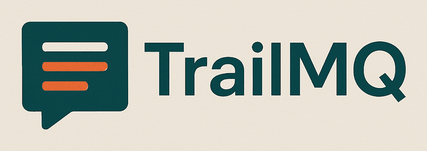
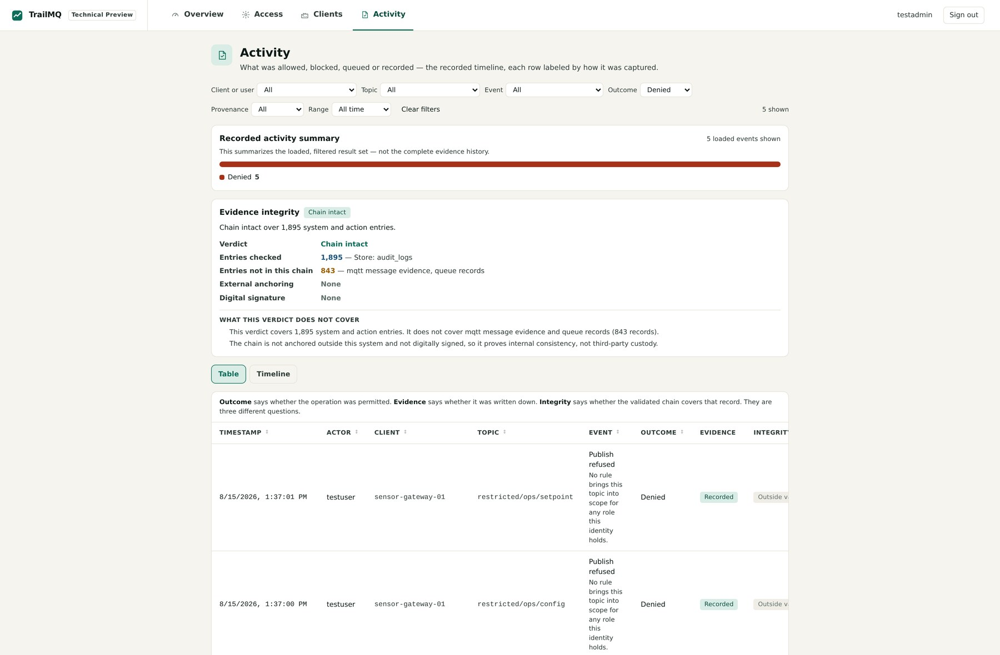
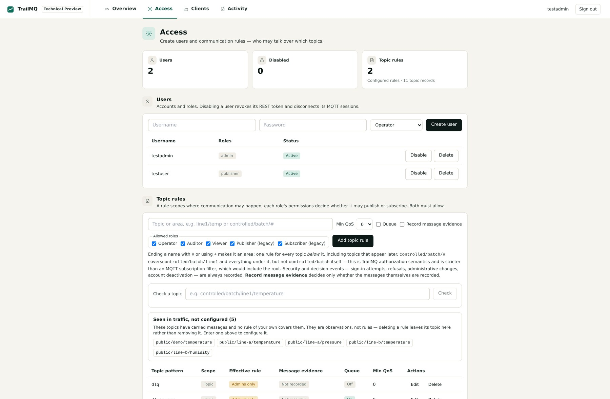

<p align="center"></p>

[](https://hub.docker.com/r/rainergewalt/trailmq-backend/tags)
[](https://github.com/RainerGewalt/TrailMQ/actions/workflows/distribution-gate.yml)
[](#release-quality)
[](LICENSE)

# Know why MQTT access was allowed or denied

**Policy-controlled MQTT for industrial systems, with attributable and
reviewable access decisions.**

When an MQTT action is refused on a plant network, "it did not work" is not an
answer. Someone still has to know who acted, under which role, on which topic,
and why the answer was no.

TrailMQ is a self-hosted MQTT broker that answers three questions where traffic
enters the system:

- **Who may do what?**
- **What happened?**
- **Why was it allowed or denied?**

Standard MQTT clients connect to it directly, without an SDK. TrailMQ is not
open source: this repository is the free evaluation package, and the runtime
ships as signed images ([what that means](docs/faq.md#is-trailmq-open-source)).

**[Try it](#try-it)** · [How access is decided](#how-access-is-decided) ·
[Trust and evidence scope](#trust-and-evidence-scope) ·
[Documentation](docs/README.md)

## One Denied Decision

```text
user      testuser (role: publisher)
action    PUBLISH restricted/ops/config
outcome   DENIED
reason    acl_role_not_in_topic_scope
```



One pass decided it, enforced it before the payload could reach a subscriber,
recorded who did what, and made it reviewable in **Activity** with the actor,
MQTT client id, topic and a plain-language reason attached.

The same identity publishing to `public/demo/temperature` is allowed. Both
outcomes come out of the [same two gates](#how-access-is-decided).

> Scope in one line: the built-in integrity verdict covers the hash-linked
> system/action audit chain; MQTT decision records are recorded and reviewed
> separately. [What the verdict does and does not prove](#trust-and-evidence-scope).

## Try It

Requirements: **Docker 20.10+**, **Docker Compose v2**, **Bash** on Linux,
macOS or WSL, and internet access for the first image pull.

```bash
git clone https://github.com/RainerGewalt/TrailMQ.git
cd TrailMQ
./trailmq try
```

`try` prepares the local evaluation stack, starts it, runs the decision proof,
prints the result in plain language, and opens the Web UI. The proof checks
more than container health — four of its seven checks:

```text
[PASS] Authorized publish reached the subscriber   public/demo/temperature
[PASS] Unauthorized publish was blocked            restricted/ops/config
[PASS] Denial recorded with user, role, action and topic
[PASS] System/action audit chain intact
```

Then look for yourself: open **http://localhost/trailmq/**, sign in as
`testadmin` (`./trailmq credentials` shows the generated password again), and
filter **Activity** by **Outcome: Denied**. The refused publish from the proof
is there with its reason attached.

Prefer separate steps? `./trailmq quickstart` → `./trailmq verify` →
`./trailmq open`, each explained in the [Quickstart](docs/quickstart.md). If
setup fails, run `./trailmq doctor` and see
[Troubleshooting](docs/troubleshooting.md).

No Git? `TrailMQ-Evaluation-3.1.1.tar.gz` from the
[v3.1.1 release](https://github.com/RainerGewalt/TrailMQ/releases/tag/v3.1.1)
is the same distribution as a download; extract it and run `./trailmq try`
inside.

### On Windows

`TrailMQ-Setup-3.1.1.exe` from the
[v3.1.1 release](https://github.com/RainerGewalt/TrailMQ/releases/tag/v3.1.1)
does the same without Git, WSL or a shell — Docker Desktop is the only
prerequisite.

It is an **unsigned evaluation build**: Windows will report an unknown
publisher, because nothing vouches for who published the file.
`SHA256SUMS-windows` from the same release confirms the file is the artifact
this release published, which is a different claim from who published it.

### Connect your own client

`./trailmq connect` prints the live endpoint, CA path, generated credentials,
allowed and denied test topics, MQTT Explorer fields, and ready-to-paste
`mosquitto` commands. Python, Node.js and browser WebSocket examples are in
[Connect an MQTT client](docs/connect-a-client.md).

## How Access Is Decided

Every PUBLISH and SUBSCRIBE passes **two independent gates**, and both have to
say yes. Authentication over MQTT/TLS or WebSocket happens once, at connect;
the gates run on every action afterwards.

**Gate 1 — what the role may do.** Permissions are `<action>:<topic-filter>`.
This is the identity from the refusal above, exactly as the evaluation ships it:

```yaml
roles:
  - id: 2
    name: publisher
    description: "Can publish messages"
    permissions: ["publish:*"]      # may publish, anywhere gate 2 allows

users:
  - username: testuser
    roles: [publisher]
```

**Gate 2 — where that permission applies.** `public/#` is open to every known
role, `restricted/#` is admin-only, and **every other namespace is
deny-by-default** until a topic rule names the roles allowed to reach it.

That is why the publish was refused. `publish:*` passes gate 1 and still loses
at gate 2, because nothing brings `restricted/ops/config` into scope for
`publisher`. A role permission does not open a namespace — and the record says
which gate said no:

| Reason on the record | Which gate |
| --- | --- |
| `acl_role_not_in_topic_scope` | Gate 2 — no rule brings this topic into scope |
| `acl_role_action_not_permitted` | Gate 1 — the role may not perform this operation |



Users, roles and topic rules are managed in **Access**, in `config.yaml`, or
over the REST API. [Access management](docs/access-management.md) covers adding,
rotating and revoking an evaluation user;
[Govern a namespace](docs/scenarios/03-governed-namespace.md) walks the second
gate end to end, and
[Why not just use a broker?](docs/scenarios/00-why-not-just-a-broker.md) runs
the same commands against default `eclipse-mosquitto` and TrailMQ side by side.

## Evaluation Preview

The public images ship a compact review UI that carries the whole path —
**decision → why → review** — on four surfaces:

| Surface | What it holds |
| --- | --- |
| **Activity** | Allowed and refused events with their reasons, and the integrity verdict |
| **Access** | Users, roles and topic rules: create, disable and delete users, add and remove topic rules |
| **Clients** | Connected publishers and subscribers with user, role and connect time |
| **Overview** | Runtime status |

The Preview manages evaluation users and topic rules. It is not the full
operations workspace; use the API or `config.yaml` for remaining policy and
lifecycle operations.

## Trust And Evidence Scope

"Was it blocked?" is really three questions — was it permitted, was it written
down, is the record covered — and conflating them is how a system ends up
claiming more than it can show. TrailMQ keeps them apart and states the limits
in its own UI, next to the verdict.

**What the integrity verdict covers.** The hash-linked chain walks the
system/action audit store: sign-ins, administrative changes, identity and role
changes, policy changes and topic-rule changes. `./trailmq verify` validates
that chain, and **Activity** shows the same verdict.

**What it does not cover.** MQTT decision records, including publish and
subscribe refusals, are recorded and reviewed separately. The validated verdict
does not prove that every MQTT payload is included, tamper-checked, externally
anchored or digitally signed.

**What it is not.** A permitted publish is an authorization result, not proof of
delivery; confirm delivery with `./trailmq verify`, a real subscriber and the
Activity decision details. TrailMQ is a technical building block, not WORM
storage, a notarization service, a CE declaration, a GMP/GxP validation, an
Annex 11 package or a 21 CFR Part 11 package.

The remaining boundaries — local demo assets and config merge semantics — are
listed under
[current evaluation boundaries](docs/README.md#current-evaluation-boundaries).

## Intended Purpose

TrailMQ Evaluation Preview is intended solely for local, non-production
technical evaluation. It is not intended for production operation,
safety-related functions, life-safety systems, emergency control, or use where
failure could directly result in injury, physical damage, or interruption of
critical operations. Production use requires a separately assessed TrailMQ
production offering and written agreement.

That paragraph is [section 2 of the license](LICENSE), word for word. Its
safety-related exclusion is the one boundary a commercial agreement about the
Evaluation Preview does not lift: such a deployment would need a different
product, separately assessed for that purpose.

## Repository Contents

This is the public, Docker-first evaluation package. **What you get today is
`3.1.1`**, tied across recipe, Docker tags, badge, bundle and
`./trailmq version` by [`release.yaml`](release.yaml).

| Path | What it is |
| --- | --- |
| [`trailmq`](trailmq) | The launcher: `try`, `verify`, `connect`, `doctor` and the rest |
| [`recipes/secure-mqtt-core/`](recipes/secure-mqtt-core/README.md) | The evaluation stack: Compose file, broker config, reverse proxy, REST API reference |
| [`docs/`](docs/README.md) | Quickstart, access model, guided scenarios, troubleshooting |
| [`cmd/`](cmd/trailmq), [`internal/`](internal) | Source of the native launcher inside the Windows build |
| [`distribution/`](distribution) | Registry page texts and the Windows installer definition |
| [`release.yaml`](release.yaml) | The release contract every published version is checked against |

The backend and frontend ship as signed Docker images. Their source is not in
this repository, and the evaluation license does not permit production or
commercial use.

## Release Quality

Releases are built by an automated pipeline and signed keyless with cosign, with
SBOM and provenance attached to the published index. Treat signatures, digests,
SBOMs and attestations as evidence for the specific tag you evaluate — see
[trust-artifacts.md](distribution/registry/trust-artifacts.md) for what they do
and do not prove, and the
[v3.1.1 release record](https://github.com/RainerGewalt/TrailMQ/releases/tag/v3.1.1)
for the current release. Security reports follow [SECURITY.md](SECURITY.md).

## Go Deeper

| Document | Use it for |
| --- | --- |
| [Documentation home](docs/README.md) | Choose the shortest path for your task |
| [Quickstart](docs/quickstart.md) | First successful proof and login |
| [FAQ](docs/faq.md) | Why a publish was denied, auth vs. authz, delivery and chain scope |
| [Connect a client](docs/connect-a-client.md) | CLI, Python, Node.js, WebSocket and access rules |
| [Guided scenarios](docs/scenarios/README.md) | Allow, deny, govern, queue, QoS and tamper exercises |
| [Access management](docs/access-management.md) | Add, rotate and safely revoke evaluation users |
| [Architecture](docs/architecture.md) | Trust model, layers and evidence scope |
| [Secure MQTT Core](recipes/secure-mqtt-core/README.md) | Recipe and REST API reference |
| [Troubleshooting](docs/troubleshooting.md) | Common setup and runtime issues |

Useful commands:

| Command | Purpose |
| --- | --- |
| `./trailmq try` | Guided first run: set up, prove, open |
| `./trailmq verify` | Run the decision proof |
| `./trailmq open` | Print the endpoints and open the Web UI |
| `./trailmq connect` | Endpoint, credentials, CA and test topics |
| `./trailmq credentials` | Show the generated evaluation passwords |
| `./trailmq status` | Services, ports and audit status |
| `./trailmq doctor` | Diagnose Docker, config, certificates, credentials and ports |
| `./trailmq down` | Stop the stack and keep local data |
| `./trailmq purge` | Remove the generated recipe runtime |

## License

TrailMQ is distributed under a proprietary evaluation license. It is free for
personal learning, local demos and non-production technical evaluation.
Production, commercial, managed-hosting, redistribution and customer-facing use
require a separate agreement.

See [LICENSE](LICENSE). Commercial contact: **contact@trailmq.com** ·
[trailmq.com](https://trailmq.com)
